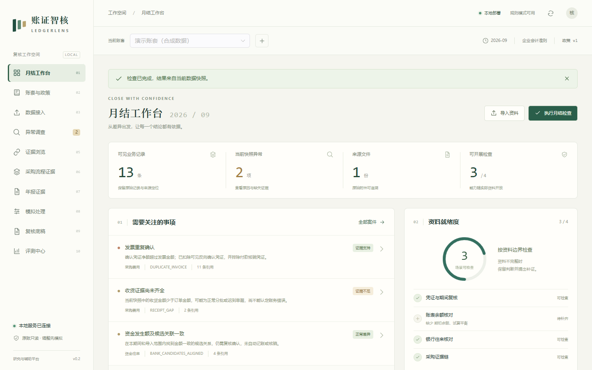
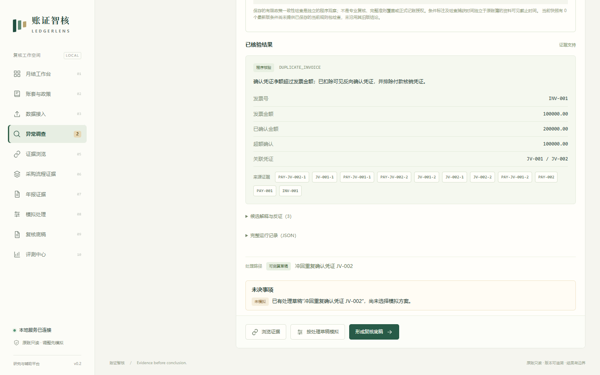
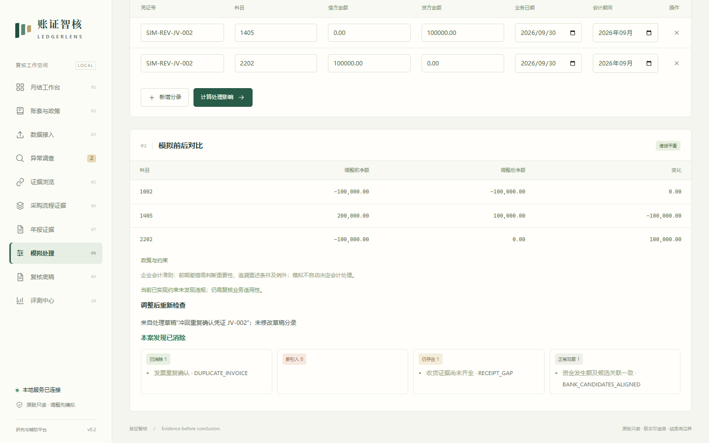
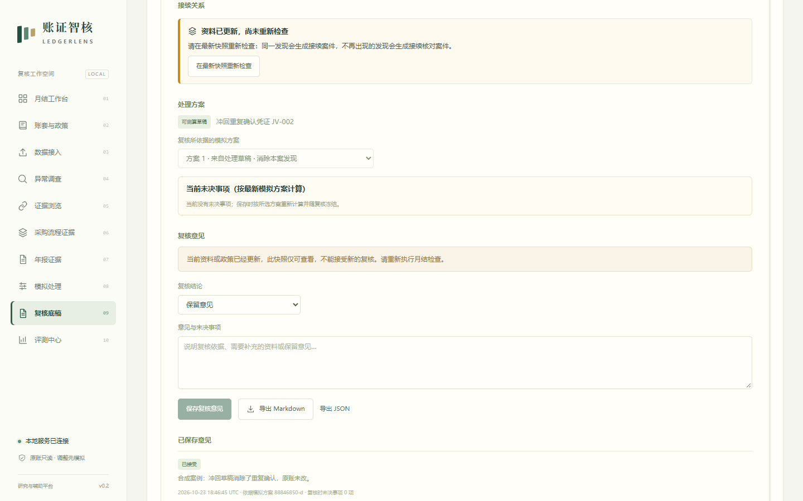
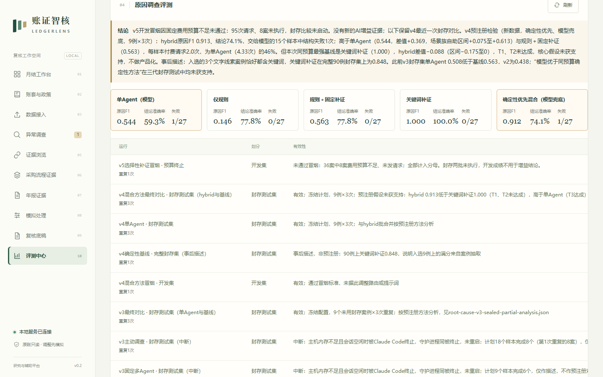
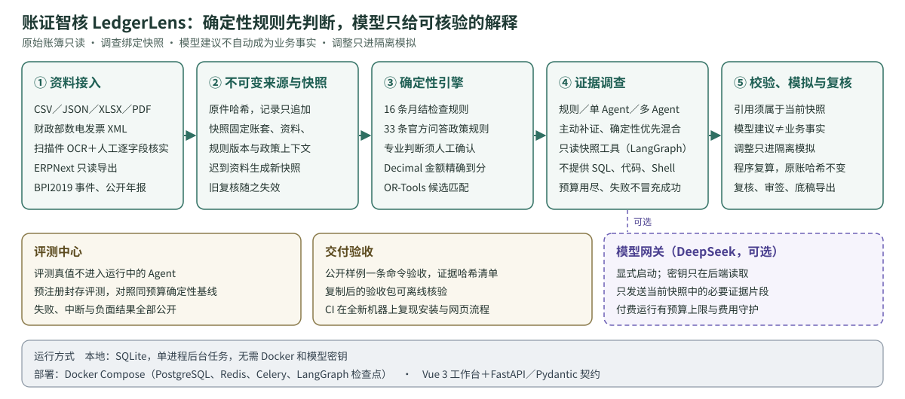

# 账证智核 · LedgerLens

[](https://github.com/longtiandragon/ledgerlens/actions/workflows/ci.yml) [](LICENSE)

**证据优先的开源会计复核工作台：确定性规则先判断，模型只给可核验的解释。** 原始账簿只读；每次调查固定账套、数据快照和规则版本；调整只进隔离模拟，由程序逐分复算。



## 它解决什么问题

月结复核中发现异常之后，还要取得证据、判断原因，并证明调整不会改坏原账。AI 直接给出的结论，常常说不清依据了哪些资料、这些资料当时是否可见。账证智核让每条结论都能回查到当前快照中的具体记录：迟到的资料会生成新快照并使旧复核失效，模型建议永远不会自动成为业务事实。

适用场景：会计、审计课程的复核实训（首个可落地场景）；代账机构与企业财务的月结复核（目标场景，真实账套试点属于后续外部验证）。

## 五分钟上手

先取得代码：`git clone https://github.com/longtiandragon/ledgerlens.git && cd ledgerlens`。Docker 方式只需要 Docker；本机方式需要 Python 3.12、Node.js ≥ 22.13 和 [uv](https://docs.astral.sh/uv/)，首次启动会自动安装依赖（约 3–10 分钟，视网络而定）。

|方式|命令|入口|
|---|---|---|
|Docker（推荐）|`docker compose up --build -d`|<http://127.0.0.1:8080>|
|Windows|`powershell -ExecutionPolicy Bypass -File scripts/start-local.ps1`|<http://127.0.0.1:5188>|
|Linux／macOS|`bash scripts/start-local.sh`|<http://127.0.0.1:5188>|

不需要模型密钥。打开后依次：新建账套 → 载入合成演示账套 → 执行月结检查 → 打开“发票重复确认”并启动调查 → 浏览证据 → 在“模拟处理”中输入调整草稿（例如借 2202、贷 1405 各 100000.00，冲回重复确认）→ 在“复核底稿”保存复核意见 → 在“数据接入”点“补充迟到收货单”，再回到“复核底稿”观察旧复核失效。三种启动方式在每次提交的 CI 中都按原样执行。

**导入自己的凭证**：在“数据接入”上传 CSV 或 XLSX，常见凭证导出表头（日期、凭证号、摘要、科目编码、借方金额、贷方金额、发票号）可直接识别。原文件没有的记录类型、会计期间和来源编号，由系统按凭证格式推导；分录一侧有金额、另一侧空白时，空白侧按 0 处理。所有推导值在预览中逐项标为“推导”，确认后才导入；两侧都空、日期无法识别等情况仍会拒绝并给出中文原因。

## 核心能力

- **导入与快照**：CSV／JSON／XLSX／文本 PDF、财政部数电发票 XML、扫描件 OCR（人工逐字段核实）；原件哈希，记录只追加。
- **确定性检查**：16 条月结检查规则；33 条来自 32 份财政部实施问答的政策规则，专业判断须人工确认。
- **证据调查**：规则、单 Agent、固定多 Agent 与主动补证模式；只读快照工具，不提供 SQL、代码或 Shell。“确定性优先”混合方法只在评测框架中实现，预注册检验未通过，未进入产品。
- **隔离模拟与复核**：调整草稿由程序复算，原账哈希不变；复核意见、可选的多用户职务分离审签、Markdown／JSON 底稿。
- **公开资料闭环**：财政部公开样例一条命令完成采集、隔离 API 与浏览器验收和证据哈希汇总，复制后可离线核验。

|调查结论带可回查的引用|调整只进隔离模拟|
|---|---|
|||
|**迟到资料使旧复核失效**|**评测中心如实展示负面结果**|
|||

## 架构



## 验证结果（截至 2026-10-20）

|项目|结果|
|---|---|
|后端测试|本机 2450 通过／25 跳过；CI 每次提交在 Linux 与 Windows 上全量运行|
|规则基准|480 个合成案例、30 个独立参考例全部通过，CI 每次重新生成数据并强制该契约|
|政策规则|33 条规则、191 个手写投影全部通过；未经会计专业人员审阅前均为 experimental|
|公开资料|财政部数电发票样例：API 45 项、Chrome 24 项全部通过|
|模型效果|v2、v3、v4 三次封存测试中，单 Agent 都没有超过同预算确定性基线（v3：宏 F1 0.508 对 0.563；v4：0.544 对 1.000），见 [ROOT_CAUSE_V3](docs/ROOT_CAUSE_V3.md)、[ROOT_CAUSE_V4](docs/ROOT_CAUSE_V4.md)|
|混合方法|“确定性优先、模型兜底”在 v4 新数据上做了预注册封存检验（2026-10-22），**未获支持**：宏 F1 0.913，高于单 Agent（0.544），请求量为单 Agent 的 46%，但低于本次最强确定性基线关键词补证（1.000）。事后看，这个满分来自案例抽取，关键词补证在完整封存集上为 0.848。见 [#12](https://github.com/longtiandragon/ledgerlens/issues/12) 与 [ROOT_CAUSE_V4](docs/ROOT_CAUSE_V4.md)|

可用性：AI 模拟的首次使用试用（不是真人试用）从全新克隆走通了演示流程和自制凭证导入，发现并修复了 5 个问题，见 [AI_FIRST_USE_TRIAL](docs/AI_FIRST_USE_TRIAL.md)。

边界：数据为合成数据与公开资料；尚未在企业真实账套上试点；AI 审阅不等于会计师意见。逐项记录见 [交付状态](docs/STATUS.md)，全部文档见 [文档导航](docs/README.md)。

## 接手开发

当前实现是本地运行的 `0.1.0` 工程版本，不是准则全面覆盖或真实企业业务效果的声明。已实现内容和仍需验证的项目见 [交付状态](docs/STATUS.md)。

接手开发请先读 [交接文档](docs/HANDOFF.md)；目标、验收门槛与当前证据见 [目标文档](docs/GOALS.md)。

## 运行与复现（详细）

需要 Python 3.12、Node.js ≥22.13 和 uv。依赖缓存及运行资料默认放在项目所在磁盘。

Windows（PowerShell）：

```powershell
if (-not (Test-Path .env)) { Copy-Item .env.example .env }
powershell -ExecutionPolicy Bypass -File scripts/start-local.ps1
```

Linux／macOS：

```bash
cp -n .env.example .env
bash scripts/start-local.sh      # 停止：bash scripts/stop-local.sh
```

只装了 Docker 时：`docker compose up --build -d`，入口为 <http://127.0.0.1:8080>（见下文 PostgreSQL 部署）。

打开 <http://127.0.0.1:5188>；API 文档位于 <http://127.0.0.1:8000/docs>。默认 SQLite 持久化，不需要 Docker 或模型密钥即可完成规则演示。三种启动方式在每次提交的 CI 中都按原样执行（quickstart-unix、quickstart-windows、docker 作业）。

依赖安装完成后，可用一条命令采集固定公开样例并在独立账库中验收API与网页：`.venv\Scripts\python.exe scripts/validate_public_delivery.py --output .local/reports/public-delivery-new`。已有官方ZIP时加`--archive .local/mof-vouchers-2025/digital-invoice.zip`即可离线复现。需已安装Node、前端依赖和Chrome；输出目录必须全新。命令保留原件、底稿、逐阶段结果与哈希清单；失败、跳过或缺失报告均不能通过。见[验收说明](docs/PUBLIC_DATA_CLOSURE.md)及[本轮结果](docs/public-delivery-validation.json)。

已经安装依赖时：`powershell -ExecutionPolicy Bypass -File scripts/start-local.ps1 -SkipInstall`。

验证当前未提交源码能否在独立目录复现，可运行`.venv/Scripts/python.exe scripts/validate_clean_checkout.py --working-tree --public-archive .local/mof-vouchers-2025/digital-invoice.zip --output .local/public-checkout-new`。需要完整uv/npm缓存及Chrome；此模式封存源码并重新安装依赖，不修改Git索引或日常账库。[本轮隔离复现](docs/CLEAN_CHECKOUT.md)已完成，跳过项目与机器边界明确保留。

启动前会核验本地SQLite结构，并在需要升级时先备份再执行冻结迁移。未知旧库结构会拒绝自动处理，见[本地数据库升级](docs/LOCAL_DATABASE_UPGRADE.md)。

停止：`powershell -ExecutionPolicy Bypass -File scripts/stop-local.ps1`。启动器仅管理自身记录的进程。

已有完整依赖缓存时，可执行 `.venv/Scripts/python.exe scripts/validate_clean_checkout.py --output .local/clean-checkout-new`，从Git提交导出干净源码，在独立空库重跑安装、数据生成、规则与网页验收。条件、保留的失败及验证边界见[干净源码复现](docs/CLEAN_CHECKOUT.md)。同样的安装、480/30规则契约和空库网页流程也在 GitHub Actions 的全新 Linux 机器上无缓存执行（`.github/workflows/ci.yml` 的 reproduce 作业），结果见[CI摘要](docs/github-ci-validation.json)。

## 体验完整流程

1. 建立账套，选择 CAS（企业会计准则）或 SCAS（小企业会计准则），期间选择 `2026-09`。
2. 加载标注为合成的十万元采购演示，或上传 CSV／JSON／XLSX。先预览字段及错误，再确认导入。
3. 执行月结检查，打开“发票重复确认”和“收货证据尚未齐全”案件。
4. 运行规则调查，查看引用、来源文件和证据关系。应收应付匹配结果仍是待复核候选。
5. 在模拟台输入平衡调整草稿，比较账户净额，确认原始记录没有改变。
6. 保存复核意见，导出 Markdown／JSON 底稿。
7. 加载迟到收货单，重新检查；旧快照仍保留，新资料使旧复核失效。

“账套与政策”另有独立政策检查：选择本制度支持的主题，填写条件、引用当前快照资料并明确人工确认，保存条件版本后执行检查、导出JSON底稿。修订只追加版本；资料更新后旧底稿仍可查看，但不能用当前资料重写历史判断。当前规则包 `policy-consistency-v5` 支持33条限定规则（CAS 31／SCAS 2），覆盖全部32份归档问答，191个手写开发投影通过；依赖专业判断的条件一律须人工确认，已接入调查的固定政策上下文；调整模拟和专业审批仍未接入，见[规则与来源](docs/POLICY_RULE_PACKAGE.md)。

该页面也支持可选的本地参考索引：查询后人工阅读、选择父条文并冻结到新快照，旧选择可回查，也可追加版本恢复默认关键词。BGE尚未优于关键词，不自动切换默认检索，见[配置与验收](docs/REFERENCE_WORKFLOW.md)。

## DeepSeek

在本地 `.env` 设置 `DEEPSEEK_API_KEY`，必要时调整 `DEEPSEEK_BASE_URL` 和 `DEEPSEEK_MODEL`，然后重启后端。密钥只由后端读取，不进入浏览器、导出或 Git。

规则模式不调用模型。单 Agent、固定多 Agent、实验性主动调查需要显式点击启动；请求会向配置的模型服务发送必要证据片段。默认每案最多24次请求、60次工具调用、200000累计Token预算。调查采用思考模式、low 推理强度、8192输出Token；失败和未知计费请求保留记录。主动模式已接入候选解释与查询选择器：协调角色提出计划，程序按服务端成本、可用性和已执行缓存选出查询，并在当前快照中执行。快照外资料仍需补证和新快照，补证请求本身不会取回资料。

当前调查源码为 `investigation-v27` / `snapshot-tools-v11`。两次独立封存测试中单Agent都没有超过同预算确定性基线：v3新数据上原因F1 0.508、结论70.4%、0/27结构失败，最强基线0.563／77.8%；v2为0.438／38.9%、6/18输出失败。v3主动调查与固定多Agent封存运行被中断，只作描述（多Agent已完成6个样本F1 0.800，未完成预注册，不能宣称）。主动补证增益的主张未获支持。见[原因调查轨道](docs/ROOT_CAUSE_TRACK.md)、[v3实验](docs/ROOT_CAUSE_V3.md)和[最新验证记录](docs/STATUS.md)。

角色读取保留[v19按需证据设计](docs/AGENT_CONTEXT_V19.md)，参考资料执行[来源与内容绑定](docs/REFERENCE_PROVENANCE.md)：新检索和快照核对登记、原件重解析及片段，旧未绑定参考不进入新的模型任务。默认政策检索仍为关键词；业务链按订单／发票字段及主体、币种限定展开，不能用同金额或日期邻近自动关联。

v15四组各重复3次，24个样本全部运行：规则6/6、单Agent6/6、固定多Agent0/6、主动3/6完成，107次API尝试。模型运行完成不等于分类正确；没有多Agent增益结论。失败分析及费用区间见 [v15试跑报告](docs/AGENT_PILOT_V15.md)。v16同条件24样本全部运行、114次API尝试：规则6/6、单Agent6/6、固定多Agent0/6、主动5/6完成；主动的规则集合仅1/6完全匹配。[v16报告](docs/AGENT_PILOT_V16.md)记录中性任务初始化缺陷及预算失败，不据此宣称多Agent增益。v17修正普通复核的异常前提、限定规则编号、加入可逆去重传输和新的受限结构修复；v17同条件24样本已结束，110次请求：单Agent6/6、固定多Agent0/6、主动5/6完成；固定多Agent产品验收仍预算失败。[v17报告](docs/AGENT_PILOT_V17.md)记录完整结果。v18改为角色独立意见与最终汇总，精简模型契约注释及重复协议；验证约束和预算保持。v18计划24行仅实际执行6个规则及3个模型任务；一次multi预算失败，随后HTTP402使15个模型任务未执行，产品multi也因402终止；[v18报告](docs/AGENT_PILOT_V18.md)保留未完成记录，未证明收益。

真实接口与工具往返：`.venv\Scripts\python.exe scripts/test_deepseek_live.py --live`。已有调查可用 `scripts/run_investigation_smoke.py --case-id ID --mode single --run-id RUN_ID` 只读验收，不产生新的模型调用。调查页支持查看历史运行。

## 验证与数据

```powershell
.venv\Scripts\python.exe -m pytest -q
.venv\Scripts\python.exe -m datasets.generate --output .local/datasets
.venv\Scripts\python.exe -m benchmarks.evaluate
.venv\Scripts\python.exe scripts/collect_sources.py
.venv\Scripts\python.exe scripts/index_sources.py
.venv\Scripts\python.exe -m datasets.official_cases --verify-only --coverage docs/official-case-coverage.json
.venv\Scripts\python.exe -m datasets.finqa --verify-only
.venv\Scripts\python.exe -m datasets.bpi2019 --verify-only
.venv\Scripts\python.exe -m datasets.bpi2019_adapter
.venv\Scripts\python.exe scripts/verify_process_locators.py
.venv\Scripts\python.exe scripts/generate_contracts.py --check
```

480个合成任务分为48个拓扑／故障配置，另有30个独立编写的非官方参考例。规则标签指标与模型效果分开统计。隐藏真值不进入调查工具；数据分区不是针对恶意本机用户的权限隔离。

另外已实际获取32条财政部实施问答（CAS 30条、SCAS 2条），保存来源、原文哈希、发布时间与题目／答案定位。原文和答案留在忽略的本地目录，运行索引不读取答案目录。当前33条独立有限政策规则覆盖全部32份问答、191个手写结构化开发投影通过；其中12份依赖专业判断的问答以人工确认条件实现，程序不代替判断。开发投影不是官方真实账套准确率。公开元数据见 [官方问答覆盖表](docs/official-case-coverage.json)、[独立规则验证](docs/official-policy-validation.json)与[规则边界](docs/POLICY_RULE_PACKAGE.md)。

FinQA已取得883条官方dev记录，题目／财报内容与答案／程序分区并核验；参考程序算术重放883/883通过（不是模型答题成绩）。32题只读文档模型试跑保留全部失败，v1为9/32、结构化步骤v2为21/32正确，下一组未查看的32题18/32正确；都不是封存测试，详见 [数值组件验证](docs/FINQA_COMPONENT_VALIDATION.md)。评测中心新增只读数值结果面板，刷新不调用模型；未知、失败与开发反馈明确保留。10家公司三年完整年报30/30通过来源、哈希及报表页筛查，7204页；[年报来源](docs/ANNUAL_REPORT_DATA.md)尚不表示金额或会计正确性。[数字组件探查](docs/ANNUAL_STATEMENT_COMPONENT.md)已固定4份原件的独立单元格对照，并完成30份本地探查：23份产生定位记录、7份明确拒绝；23/30不是正确率。打开“年报证据”可切换新旧快照、筛选、回查原PDF及高亮单元格，跨行标签定位完整保留；页面独立于会计账套和Agent。[接入与复现](docs/STATEMENT_WORKSPACE.md)。BPI2019已下载完整原XES并核验官方MD5，首次1000个完整trace共15351事件已转为独立的流程证据快照。打开“采购流程证据”可搜索采购项、分页查看事件和定位原字段；不需要会计账套，不调用模型。重复导入实测复用同一快照；独立核验1000个trace、15351个事件和92755个字段指针通过。匿名事件不生成CNY分录，也没有异常原因真值。Beancount 3.2.3作为可选评测工具，9个基础账例差分通过、39项回归通过；仅覆盖单一CNY的余额及不平衡检查。见 [数据与验证](docs/DATA_AND_EVALUATION.md)及 [Beancount差分](docs/BEANCOUNT_DIFFERENTIAL.md)。

前端：`cd frontend; npm ci; npm run build; npm run test:e2e`。端到端测试使用真实本地 API，新建标注为测试用途的账套，不调用付费模型。

真实BPI页面验收需先导入数据，再在frontend目录执行`$env:PROCESS_DATASET_TESTS='1'; npm run test:e2e`；未设置时跳过本机数据测试，仍执行空状态和会计流程测试。采集器、只读页面及费用估算器均不调用模型。

四组报告可离线估算费用：`.venv\Scripts\python.exe -m benchmarks.costs --report .local/reports/deepseek-pilot-v15.json --output .local/reports/deepseek-pilot-v15-costs.json`。采用2026-10-08核验的官方USD价格，报告已知用量的峰谷价格区间和未知请求，不推算人民币账单或账户余额；已有输出拒绝覆盖。

DeepSeek真实JSON、思考模式工具往返、单Agent账务调查及v8／v10主动调查已通过。v10主动调查6次请求、90292 Token、8次工具调用，12条不同引用均可定位，原账簿前后哈希一致。试跑中的截断、预算耗尽、HTTP 402及批次中断均保留，不能据此声称多Agent有增益。详细实测、测试版本和未完成能力见 [交付状态](docs/STATUS.md)。

## 多用户审签（可选）

默认单用户本地模式无需登录。设置 `AUTH_MODE=multi_user` 后，调查、复核、审批须由不同账户完成，首个管理员用 `python -m app.manage_users create ...` 在本机创建，详见[运行手册](docs/RUNBOOK.md)。

## PostgreSQL 部署

Compose 配置使用 PostgreSQL、Redis、Celery、持久化 LangGraph 检查点；所有对外端口绑定 loopback。2026-10-11 已实机联调：20项容器验收连续两次通过（迁移、重复投递、Worker停机、失效租约恢复、全栈重启与持久化）；2026-10-14 用当前镜像复验再次连续两次通过，并验证旧库升级保留及验收中断后的服务恢复，见[状态](docs/STATUS.md)。按 [运行手册](docs/RUNBOOK.md)执行 `docker compose up --build -d`，入口为 <http://127.0.0.1:8080>（可用 `WEB_PORT` 改端口）。

## 文档

全部 53 份文档按读者分组列在 [文档导航](docs/README.md)。常用入口：

- [PRD 与验收范围](docs/PRD.md)
- [技术设计与接口](docs/TECHNICAL_DESIGN.md)
- [数据、评测与专业边界](docs/DATA_AND_EVALUATION.md)
- [官方问答规则、条件版本与政策检查](docs/POLICY_RULE_PACKAGE.md)
- [调查中的固定政策检查及读取约束](docs/INVESTIGATION_POLICY_CONTEXT.md)
- [参考来源绑定与历史快照](docs/REFERENCE_PROVENANCE.md)
- [四组真实模型试跑及失败分析](docs/AGENT_PILOT_V15.md)
- [交付状态与未验证项目](docs/STATUS.md)
- [成熟项目借鉴与许可](docs/THIRD_PARTY.md)
- [实施路线图与BPI证据接入](docs/ROADMAP.md)

## 参与与治理

- [贡献指南](CONTRIBUTING.md) · [项目治理](GOVERNANCE.md)（含 AI 辅助开发规则） · [行为准则](CODE_OF_CONDUCT.md)
- [安全策略](SECURITY.md) · [维护者与招募](MAINTAINERS.md) · [获取帮助](SUPPORT.md) · [引用本项目](CITATION.cff)

自主代码采用 Apache-2.0。第三方依赖、模型与公开资料保留各自许可。
